# MODEL INTERPRETABILITY & ERROR ANALYSIS REPORT

**Phase 6 - lap-time model.** Status: complete.

Phases 4-5 answered "how accurate is each model?". This phase answers the
next question: **why does the lap-time model make the predictions it makes,
and where and why does it fail?** The lap-time model is the subject because
it is the project's anchor problem (`docs/PHASE_4_REPORT.md`).

> **Final-audit correction (docs/FINAL_AUDIT.md).** When this phase was
> written, Ridge was believed to beat its strong baseline. The final audit
> added the baseline a race engineer would use first - **stint pace
> persistence** (predict the stint's own mean lap time so far) - and it
> scores **3.669s MAE** against Ridge's 5.953s, so **no lap-time model
> beats the strongest baseline** and nothing is serialized. Everything
> below remains a correct description of *what Ridge does and why it
> errs*; read "best model" as "best ML candidate". Section 2a explains,
> from this analysis, exactly why Ridge loses to persistence.
The tooling built here is generic, so the Phase 5 models can be analysed
the same way later.

Reproduce: `python -m mpp.evaluation.analyze_lap_time` (after
`python -m mpp.models.train_lap_time`). Generated tables:
`data/quality/interpretability_lap_time.{json,md}`. Figures:
`docs/figures/phase6/`.

> **Read every importance number in this report as predictive reliance,
> not causation.** "The model relies on X" means "the model's held-out
> error gets worse when X's information is destroyed". It does not mean
> "X makes the car slower". Section 7 lists the specific confounds.

---

## How the analysis was done (and why it can be trusted)

- **Every number is out-of-fold.** The analysis refits the six Phase 4
  leave-one-race-out Ridge models, using the same deterministic folds and
  the per-fold `alpha` that nested CV selected
  (`model_comparison_lap_time.json`). Each lap is predicted only by a model
  that never saw its race. The reproduced mean per-fold MAE is
  **5.953s**, identical to Phase 4's 5.953s, which confirms the analysis is
  examining the same predictions Phase 4 scored.
- **Permutation importance runs on those out-of-fold predictions**, not
  on training data, so it measures what the model relies on to
  *generalize*.
- **Derived features are permuted together.** `tyre_age`, `tyre_age_sq`
  and the five `tyre_age_x_<compound>` columns are deterministic functions
  of one another. Shuffling one alone leaves the information recoverable
  from its siblings. `lap_number`/`race_fraction` and `air_temp`/
  `track_temp` are grouped for the same reason.
- **Two permutation schemes.** Shuffling *across all races* and shuffling
  *only within each race* answer different questions. A feature that
  matters only in the across-race scheme helps the model tell races apart
  (a race-identity signal). It does not explain lap-to-lap variation.
- **Partial dependence recomputes derived columns.** When tyre age is
  varied, `tyre_age_sq` and the compound interactions are recomputed, so
  the curve never evaluates impossible inputs such as `tyre_age=30` with
  `tyre_age_sq=4`.
- **Failure explanations come only from recorded evidence.** Every
  candidate cause is checked against the *sign* of the error (a
  safety-car lap can explain an underprediction but not an
  overprediction). Laps with no sign-consistent recorded cause are
  labelled unexplained.

Residual convention throughout: **residual = prediction - actual**.
Positive means the model predicted a lap that was too slow
(overprediction). Negative means it predicted a lap that was too fast
(underprediction).

---

## 1. Best model

**Best ML candidate: Ridge regression (`alpha=100`)** - it does not beat
the stint-pace-persistence baseline (section 2a), so it is analysed, not
deployed. Model: on 20 inputs: 18 numeric features plus
one-hot `compound` and `session_type`. Numeric features are median-imputed
and standardized inside the pipeline. Circuit, driver and team identity
are **not** model inputs.
`driver_circuit_prior_relative_pace_s` is excluded because it is 100% null
in this scope (Phase 4).

## 2. Performance metrics

Leave-one-race-out, 2023 rounds 1-6, 6,145 laps.

| held-out race | MAE (s) | RMSE (s) | median AE (s) | R² |
|---|---|---|---|---|
| 2023_1 Bahrain | 2.94 | 4.55 | 2.38 | -0.88 |
| 2023_2 Jeddah | 4.29 | 8.17 | 1.87 | -0.17 |
| 2023_3 Albert Park | 5.10 | 8.91 | 2.19 | 0.23 |
| 2023_4 Baku | **14.51** | 15.71 | 13.77 | -6.03 |
| 2023_5 Miami | **1.07** | 1.79 | 0.63 | -0.13 |
| 2023_6 Monaco | 7.81 | 8.87 | 7.54 | 0.03 |
| **mean of folds** | **5.95** | 8.00 | 4.73 | -1.16 |

The strong (per-circuit-median) baseline scores 8.96s. The best race
(Miami, 1.07s) and the worst (Baku, 14.51s) differ by more than 13x, so
the 5.95s mean describes no single race well.

Within-race R² values are low or negative because a single race has
little lap-time variance to explain, and any constant offset destroys
R². Pooled across all races, R² is 0.32.

Error depends heavily on track conditions:

| subset | MAE (s) |
|---|---|
| all laps | 5.93 |
| green-flag laps | 5.20 |
| neutralised laps (SC / VSC / yellow) | 14.29 |
| green laps, after removing each race's mean offset | 2.39 |
| green laps, later in a stint, no neutralised lap earlier in the stint, race offset removed | **1.34** |

The last row approximates the model's skill at the task it is actually
equipped for: ranking laps within a race under racing conditions.

### 2a. Against stint pace persistence (added in the final audit)

| held-out race | Ridge MAE (s) | persistence MAE (s) |
|---|---|---|
| Bahrain | 2.94 | **1.71** |
| Jeddah | **4.29** | 5.15 |
| Albert Park | **5.10** | 6.04 |
| Baku | 14.51 | **4.67** |
| Miami | **1.07** | 1.09 |
| Monaco | 7.81 | **3.35** |
| **mean of folds** | 5.95 | **3.67** |

On green-flag laps later in a stint (5,465 laps), persistence is 2.76s
MAE and Ridge 5.12s. The reason follows directly from section 5 below.
Ridge moves only 0.46-0.77s per second of stint pace, i.e. it shrinks
toward the training races' pace. Persistence has an implicit slope of
exactly 1. That shrinkage pays off only where the stint history is
corrupted by neutralisations (Jeddah, Albert Park). It costs about 10s at
Baku and 4.5s at Monaco, whose pace sits far from the other circuits'.
With no circuit repeats, nothing a cross-circuit model learns about pace
*level* can transfer, so the best available predictor of a lap's pace is
that same stint's pace.

## 3. Most important features

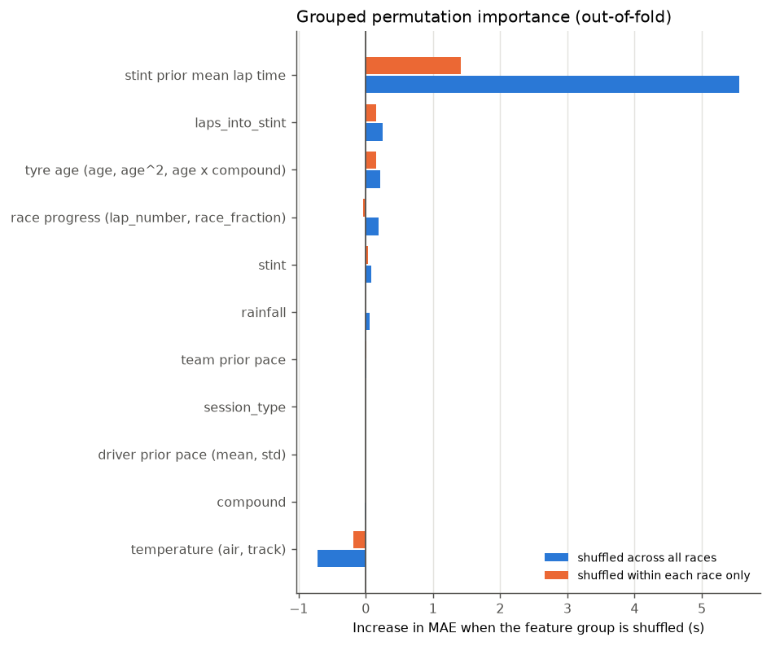

Increase in out-of-fold MAE (seconds) when a feature group is shuffled:

| feature group | across races | within race only |
|---|---|---|
| stint prior mean lap time | **+5.56** | **+1.41** |
| laps_into_stint | +0.25 | +0.16 |
| tyre age (age, age², age × compound) | +0.22 | +0.15 |
| race progress (lap_number, race_fraction) | +0.19 | -0.04 |
| stint | +0.08 | +0.04 |
| rainfall | +0.06 | 0.00 |
| team prior pace | +0.01 | +0.01 |
| driver prior pace (mean, std) | -0.00 | 0.00 |
| compound | -0.01 | 0.00 |
| session_type (constant "R") | 0.00 | 0.00 |
| **temperature (air, track)** | **-0.72** | **-0.19** |

Key findings:

1. **The model is, in effect, "recent stint pace + small corrections".**
   `stint_prior_mean_lap_time_s` is the expanding mean of the stint's
   earlier clean laps. Shuffling it more than doubles MAE, from 5.93s to
   about 11.5s. Every other group combined is worth less than 1s.
2. **Temperature has negative importance.** Shuffling air and track
   temperature makes held-out predictions *better* by 0.72s. The model
   uses temperature in a way that does not transfer to unseen races. This
   directly confirms Phase 4's hypothesis that weather acts as a
   race-identity proxy. `track_temp` alone scores -1.15s. Its coefficient
   even changes sign between fold models (from -3.03 to +1.98 seconds per
   SD), so it is fitting race-specific noise, not a stable physical
   effect.
3. **Driver and team prior-pace features contribute nothing** (|importance|
   ≤ 0.01s). Their coefficients also flip sign across folds. With only
   1-5 prior rounds per driver, the relative-pace history is too short to
   carry signal yet.
4. **Correlated features split credit.** Individually, `lap_number`
   (+1.12s) and `race_fraction` (+1.07s) look important. Grouped, they are
   worth only +0.19s across races and -0.04s within a race. Their
   coefficients have opposite signs (-2.40 and +2.18 per SD) and largely
   cancel. Shuffling one breaks the cancellation, which inflates the
   single-feature score. This is why grouped importance is the number
   reported here.

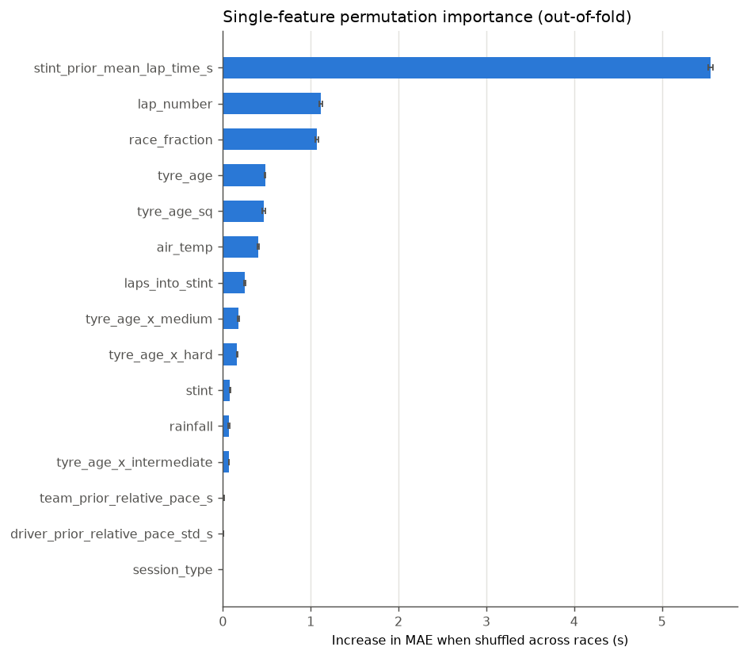

**Model-native importance (Ridge coefficients, mean ± std across the 6
fold models).** Values are seconds per one standard deviation of a
standardized numeric feature, or seconds of offset for a one-hot level.
Orange bars increase the predicted lap time; blue bars decrease it.

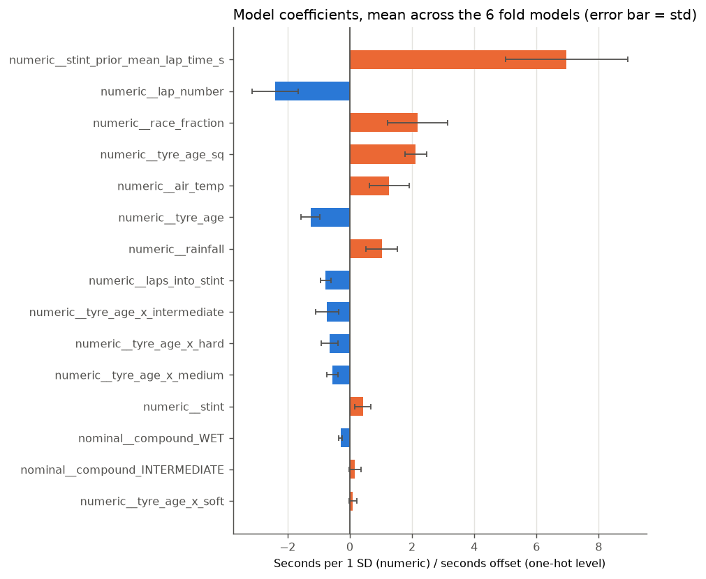

The coefficient ranking agrees with permutation importance at the top:
stint prior pace is +6.96 per SD, and its sign is stable in all folds.
Coefficient size alone overstates `air_temp` and `lap_number`, which is
why coefficients are not the primary importance measure here.

**Partial dependence.** Moving each feature from its 5th to its 95th
percentile shifts the mean prediction by:

| feature | p05 → p95 | Δ mean prediction (s) |
|---|---|---|
| stint_prior_mean_lap_time_s | 78.6 → 112.1 s | +21.99 |
| lap_number | 3 → 61 | -7.55 |
| race_fraction | 0.05 → 0.95 | +6.74 |
| air_temp | 17.7 → 27.3 °C | +4.12 |
| laps_into_stint | 2 → 41 | -2.38 |
| track_temp | 28.9 → 42.2 °C | +0.61 |

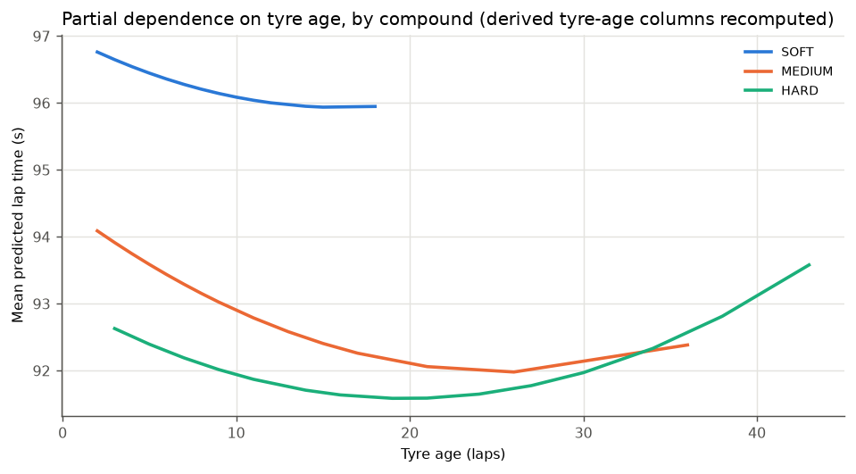

The tyre-age curves **fall** over the first 15-25 laps of a stint for
every dry compound, and only the HARD curve turns upward late. This
should **not** be read as "tyres get faster with age". Tyre age is
confounded with fuel burn (every lap is lighter), and the dataset has no
fuel-mass variable to separate the two (the same confound identified for
tyre degradation in `docs/PHASE_5_REPORT.md`). The curve is the model's
learned association between tyre age and lap time, net of everything else
it sees. It is not a degradation measurement. The SOFT curve sits about
4s above MEDIUM/HARD for the same reason: 414 of the 492 soft laps come
from Bahrain, so "SOFT" partly encodes "Bahrain".

## 4. Residual behavior

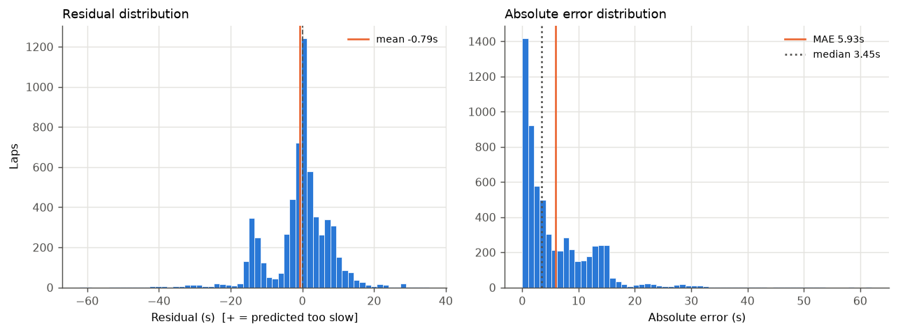

| statistic | value |
|---|---|
| mean residual | -0.79s |
| median residual | +0.22s |
| std | 8.85s |
| skewness | -1.07 |
| 5th / 95th percentile | -14.9s / +10.9s |
| MAE / median AE / 90th pct AE | 5.93s / 3.45s / 14.27s |
| largest under / overprediction | -62.1s / +35.4s |
| share over / under predicted | 52.9% / 47.1% |

The distribution is **left-skewed**. The bulk of laps is slightly
overpredicted (median +0.22s), but a long tail of laps was driven much
slower than predicted. Those are almost all neutralised laps (section 5).
MAE is 1.7x the median AE, so a minority of laps dominates the average.

**The single most important residual fact:**
**50.9% of the mean squared error is a constant per-race offset.**
Mean squared error decomposes exactly into between-race and within-race
parts: of the MSE of 79.0 s², 40.2 s² is each race's mean residual
repeated on every lap. Half the error is not lap-level noise. It is the
model placing a whole race's pace band at the wrong level.

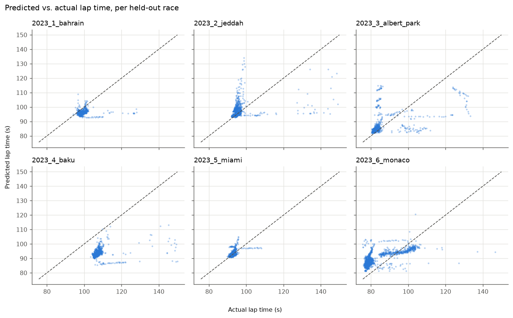

Per held-out race, the clouds are displaced from the diagonal: Baku sits
far below it and Monaco above it. Two artefact shapes are also visible:

- **horizontal streaks**: laps that were very slow (130-150s) but were
  predicted at normal pace. These are safety-car and VSC laps.
- **vertical streaks**: laps driven at normal pace but predicted 110-135s.
  These are the green laps right after a neutralisation, whose stint
  history is inflated (section 6).

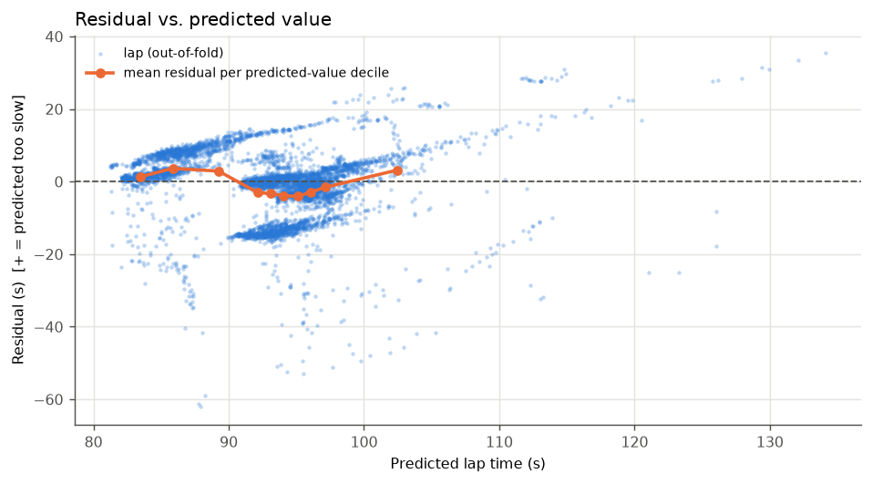

Mean residual by predicted-value decile follows a clear pattern. The
lowest predictions (about 83-89s, mostly Monaco and Albert Park) are
overpredicted by 1.3-3.7s. The middle band (about 92-97s) is
underpredicted by 1.6-4.1s; Baku laps predicted in this band actually ran
around 107s. The top decile, which contains the inflated post-SC laps, is
overpredicted by 3.1s.

## 5. Systematic errors

`systematic_bias_table` labels a group as over- or underpredicted only
when its normal-approximation 95% interval excludes zero and the bias is
at least 0.5s. Laps are not independent, so these intervals are
optimistic: they screen for "consistently one-sided", and are not formal
significance tests.

**By circuit / race - the dominant systematic error.**

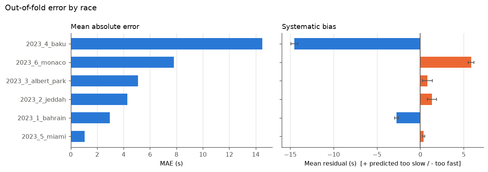

| race | median actual lap | median predicted | mean bias | MAE |
|---|---|---|---|---|
| Baku | 107.2s | 93.6s | **-14.51s (under)** | 14.51s |
| Monaco | 79.2s | 88.6s | **+5.86s (over)** | 7.81s |
| Bahrain | 98.4s | 96.2s | -2.75s (under) | 2.94s |
| Jeddah | 95.3s | 96.6s | +1.34s (over) | 4.29s |
| Albert Park | 82.9s | 84.8s | +0.82s (over) | 5.10s |
| Miami | 92.8s | 92.9s | +0.39s (no clear bias) | 1.07s |

The bias runs opposite to the race's own pace level: the correlation
between race median lap time and race mean residual is **-0.87** (6
races). Slow circuits are predicted too fast and fast circuits too slow,
i.e. predictions are **pulled toward the training mean**. The fitted
models show the mechanism directly: one extra second of stint-prior pace
moves the prediction by only **0.46-0.77s** depending on the fold, not
1s. When a held-out circuit sits far from the training races' pace
(Baku, Monaco), that shortfall becomes a race-wide offset. Phase 4 named
this problem: there is no circuit-identity feature, and no circuit
repeats in scope.

**By track status - the largest per-lap error source.**

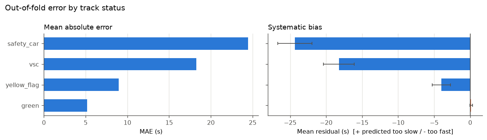

| track status during lap | laps | mean bias | MAE |
|---|---|---|---|
| safety car | 139 | **-24.34s** | 24.44s |
| virtual safety car | 53 | **-18.24s** | 18.24s |
| yellow flag | 304 | -4.01s | 8.96s |
| green | 5,649 | +0.13s (no clear bias) | 5.20s |

These are "valid" laps under Phase 2's cleaning rules, which exclude only
pit in/out laps and missing times. Neutralised laps are 8.1% of laps but
carry **19.4% of all absolute error**. On green laps the model has no
systematic bias.

**By lap phase.**

| lap phase | laps | mean bias | MAE |
|---|---|---|---|
| race lap 1 | 108 | -10.08s (under) | 13.45s |
| first lap of a stint | 177 | -5.00s (under) | 11.01s |
| later stint laps | 5,860 | -0.49s (no clear bias) | 5.64s |

Lap 1 is a standing start in a congested field. Its mean residual is
negative at five of the six races (-5.4s to -29.3s). The exception is
Monaco (+10.6s), where the large positive race offset dominates.
On the first lap of a stint, `stint_prior_mean_lap_time_s` is missing and
gets median-imputed **from the training races, i.e. other circuits**
(93.8s when Baku is held out, against Baku's real 107.2s).

**By compound.** MEDIUM +0.55s (over), HARD -1.12s (under), SOFT -1.64s
(under); INTERMEDIATE and WET show no clear bias. These differences are
largely **race composition, not tyre behaviour**. All 416 wet-tyre laps
are from Monaco. 84% of SOFT laps are from Bahrain, a -2.75s race. HARD
dominates Baku. The compound tables cannot be read as "the model
misjudges hard tyres".

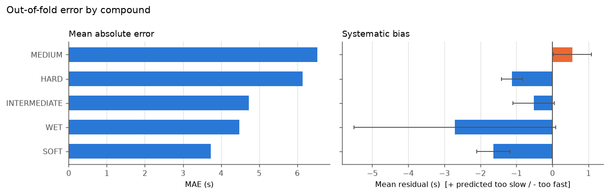

**By tyre age.** Error is highest on fresh tyres: age 0-5 has MAE 9.07s
and bias -1.77s. MAE falls to about 5s from age 11 onward, and ages 16+
show no clear bias. Fresh tyres coincide with stint starts, i.e. the
imputed stint history plus restart and out-lap-adjacent laps, rather than
with any identifiable tyre effect.

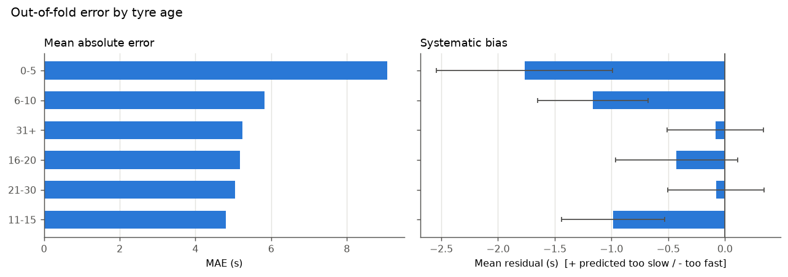

**By driver and team.** Per-driver MAE spans 5.0-6.8s. Biases range from
-1.5s to +0.7s, and most intervals are wide. Several drivers and teams
are flagged as underpredicted by around 1s, but that matches the overall
-0.79s mean residual rather than anything driver-specific. No team's MAE
differs from another's by more than 1.4s. **Nothing in this scope
indicates a driver- or team-specific failure.** Since identity is not a
model input, this is a check that no single entrant is systematically
mis-modelled, and none is.

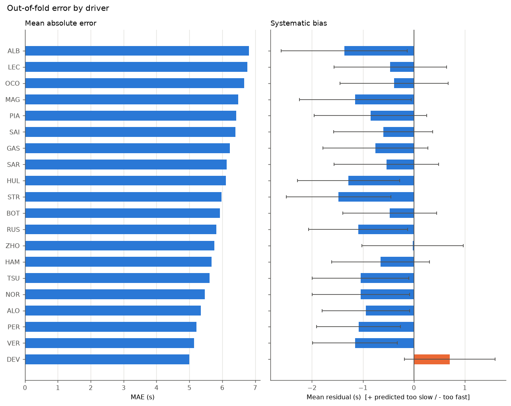
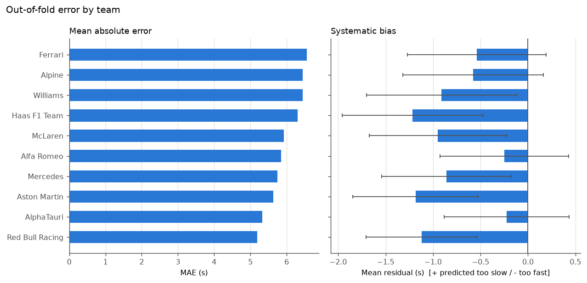

**By session.** Not analysable: `session_type` is "R" for every row
(`config/settings.toml` scopes the project to races). It is reported as
N/A, not omitted.

**Unusual observations.** After removing each race's mean offset, **722
laps** have a robust (median/MAD) z-score above 3.5. Neutralised laps are
8.1% of all laps but **43%** of these unusual laps. Of the 411 unusual
*green* laps, 322 follow a neutralised lap in the same stint, 56 are
lap 1 or the first lap of a stint, and 130 are on wet-weather days at
Monaco (the categories overlap).

## 6. Model weaknesses - representative failures

The 16 cases are picked by three different rules so that one cause
cannot crowd the list:

1. the 6 largest absolute errors overall;
2. the next 4 largest errors after removing each race's offset;
3. the 6 largest errors on green-flag laps after lap 1, after removing
   each race's offset.

Full text for all 16 is in `interpretability_lap_time.md`. Each pattern
below is represented by one example.

**A. Safety-car laps predicted at racing pace (Baku, laps 11-13).**
HAM, Baku lap 11: actual 149.99s, predicted 87.93s, residual **-62.1s**.
`track_status=4` (safety car) is recorded for the lap, and track status is
not a model feature. It is also HAM's first lap on new HARDs, so the
missing stint history was imputed as 93.8s, 13.4s faster than Baku's
median. About 23% of the error is Baku's race-wide offset. Five of the
six largest errors are this same Baku safety-car period.
*Explained by recorded data.*

**B. Safety-car restart at Jeddah (lap 20).** SAR, Jeddah lap 20:
actual 144.92s, predicted 95.43s, residual -49.5s. Track status was
`41` (SC then green), and it was the first lap of a stint.
*Explained.*

**C. The lap after a safety car, predicted ~30s too slow (Jeddah lap
21).** SAR, Jeddah lap 21: actual 98.70s (green, normal pace),
predicted 134.10s, residual **+35.4s**. The stint's only earlier clean
lap was the 144.9s safety-car lap above, so `stint_prior_mean_lap_time_s`
is 144.9s, 49.7s above the race median. The model's most important
feature carries the neutralised pace forward. ZHO, LEC and ALB on the
same lap fail identically. *Explained, and a genuine model/feature
design weakness* (section 7).

How general is pattern C? Within Jeddah, green laps whose stint contains
an earlier neutralised lap have MAE 6.05s, against 1.35s for those that
do not. **At the other races the difference is small or reversed**
(Bahrain 2.48 vs 2.37s, Baku 13.13 vs 15.43s). Pooled across races the
gap looks large (7.36 vs 2.63s), but **that pooled comparison is
confounded by race**: Miami has no affected stints and is the
best-predicted race, while Baku has 722 affected laps. The contamination
is a real mechanism that is severe right after a full safety car. It is
not a dataset-wide error driver.

**D. A slow green-flag lap at Albert Park (HAM, lap 10).** Actual
123.62s, predicted 94.50s, residual -29.1s. The lap is recorded as
`track_status=1` (green), dry, with driver history present. It is the
first lap of a stint; the imputed stint history (97.2s) is *slower* than
Albert Park's median (82.9s), which would push the prediction the wrong
way to explain this error. **No recorded cause explains this lap. It is
unexplained by the available data.** The 2023 Australian GP did have
red-flag periods, and a restart-related lap is a plausible reading, but
this lap's own status code does not show it, so this report does not
assert it. The next lap (HAM lap 11: +31.0s overpredicted) is explained:
its stint history *is* that 123.6s lap.

**E. Wet laps at Monaco.** MAG, Monaco lap 58 (WET compound, rainfall,
yellow flag): residual -52.3s. TSU lap 68 (INTERMEDIATE, yellow): -42.4s.
Every wet-weather lap in scope is from this one race, so in its
held-out fold the model was trained on **zero** wet laps. The yellow
flag is consistent with the error's sign. The median-imputed stint
history is not, and is reported as such.

**Causes that cannot be assessed.** Traffic (no gap-to-car-ahead data),
car damage, driver error, team orders and fuel- or tyre-saving strategy
are not recorded in this dataset. **None of the failures above is
attributed to them, and none can be ruled out.** Of the 16 representative
failures, **1** (D) has no sign-consistent recorded cause.

## 7. Engineering interpretation

What the model has actually learned, in race-engineering terms:

- **It is a pace-persistence model.** Its prediction is roughly "this
  stint's pace so far, shrunk toward the field average, plus small
  tyre-age and race-progress corrections". This explains both its
  strength and its main weaknesses. It is good mid-stint at a circuit
  whose pace is near the training average: green, later-stint laps, with
  the offset removed, are predicted to about 1.3s. It fails when the
  pace level is new (a new circuit) or the recent history is
  unrepresentative (neutralisation).
- **What it is not:** it does not encode tyre degradation, circuit
  characteristics, or driver skill in any separable form. The tyre-age
  effect is entangled with fuel burn. Circuit effects reach the model
  only indirectly, through stint history and the unstable temperature
  proxy. Driver and team prior-pace features have no measurable effect
  yet.
- **Confounding to keep in mind when reading any importance number:**
  1. *Temperature ↔ circuit identity*: with six circuits and no repeats,
     temperature identifies the race; its negative importance shows the
     model is hurt by it.
  2. *Tyre age ↔ fuel load ↔ race progress*: all increase together
     within a stint and cannot be separated without fuel data.
  3. *Compound ↔ circuit ↔ weather*: SOFT is mostly Bahrain, wet
     compounds are only Monaco, so compound importance and compound
     error both partly measure "which race".
  4. *`stint_prior_mean_lap_time_s` ↔ the target*: it is a lagged
     version of the target itself. It is legitimate (only completed laps
     are used, which is information an engineer has live), but its
     dominance means the model mostly reproduces recent pace rather than
     explaining it.

Highest-value fixes, ordered by the error each addresses:

| fix | addresses | evidence |
|---|---|---|
| Model the *deviation from stint pace* rather than absolute lap time, and gate on persistence | Ridge loses to persistence (5.95 vs 3.67s); a quick audit check of Ridge on the persistence residual reached 4.24s, still not enough, so this needs the fixes below too | section 2a, docs/FINAL_AUDIT.md |
| Widen season scope so circuits repeat; add circuit identity / per-circuit prior pace | 50.9% of MSE (race offset); 0.46-0.77 slope shortfall | sections 4-5 |
| Add `track_status` (or SC/VSC flags) as a feature, or exclude neutralised laps from the target | 19.4% of absolute error on 8.1% of laps | section 5 |
| Compute `stint_prior_mean_lap_time_s` over green-flag laps only | pattern C (Jeddah post-SC laps +30-35s) | section 6 |
| Impute the missing stint history from the same race (e.g. the field's prior-lap median), not the cross-circuit training median | first lap of stint: -5.0s bias, 11.0s MAE | section 5 |
| Drop or regularise `air_temp`/`track_temp` until circuits repeat | -0.72s permutation importance (removing them helps) | section 3 |

The first three are feature changes that use data the pipeline already
has (`track_status` is in `laps_features.parquet`). The first is a
config-only change. None of these changes is made in this phase, which
by brief is analysis only. Changing features would also invalidate the
Phase 4 comparison this analysis reproduces.

## 8. Limitations

- **Six races, six circuits, no repeats.** Every per-race conclusion rests
  on one race. "Baku is hard" cannot be separated from "Baku 2023's
  safety-car period was long" or "Baku is far from the training pace
  band".
- **Permutation importance has known blind spots.** It can produce
  out-of-distribution rows (e.g. a Monaco lap with Baku's temperature),
  and it measures reliance *of this model*, not the information content
  of a feature. Grouping and the within-race variant reduce these
  problems but do not remove them.
- **Partial dependence assumes features vary independently.** The
  tyre-age curves average over combinations (age, race progress, fuel)
  that never co-occur on track. Read their shape, not their absolute
  level.
- **Ridge coefficients are conditional on the other features** and on
  standardization. Correlated features (lap_number/race_fraction,
  tyre_age/tyre_age_sq) have individually uninterpretable coefficients.
- **Bias confidence intervals assume independent laps**, so they are
  too narrow. Group labels are screening flags, not significance tests.
- **Failure annotation is limited by recorded data.** Track status is
  per-lap and coarse (a lap tagged `41` was only partly under the safety
  car). There is no traffic, damage, fuel or strategy data, so those
  causes are left unassessed rather than inferred.
- **Pattern C's pooled effect is confounded by race**, as shown above. The
  within-race comparison is the trustworthy one, and it covers only one
  strongly affected race.
- **Scope is the lap-time model only.** The same tooling
  (`mpp.evaluation.interpretability`, the Phase 6 additions to
  `mpp.evaluation.error_analysis`, `mpp.evaluation.plots`) applies to the
  tyre-degradation, race-pace and pit-stop models, but those analyses are
  not run here.

---

## What was built

| module | contents |
|---|---|
| `mpp.evaluation.interpretability` | `permutation_importance` (grouped columns, optional within-stratum shuffling), `FoldRoutedPredictor` (out-of-fold routing), `model_feature_importance` (linear coefficients / tree impurity importances with encoded feature names), `partial_dependence` (with `derive` hook), `quantile_grid` |
| `mpp.evaluation.error_analysis` (extended) | `add_residuals`, `residual_summary`, `error_vs_predicted`, `between_group_error_share` (exact MSE decomposition), `systematic_bias_table`, `robust_z`, `flag_unusual_observations`, `classify_track_status` |
| `mpp.evaluation.plots` | feature importance, importance comparison, predicted vs actual (faceted), residual vs predicted, residual and absolute-error distributions, grouped error/bias, partial dependence; Agg backend, `save_figure` |
| `mpp.evaluation.analyze_lap_time` | entry point: reproduce out-of-fold predictions, run all analyses, annotate failures from evidence, write JSON/Markdown and figures |

The existing Phase 4/5 code is unchanged apart from these additions. All
existing `error_analysis` functions keep their signatures and behaviour.

## Testing performed

36 new tests (26 in three new test files and 10 added to `test_error_analysis.py`), all passing. The full suite is 214 passed.

- **Interpretability calculations**: a known-linear model gives zero
  importance for an unused feature and the largest for the used one;
  results are seed-deterministic; joint permutation keeps derived
  columns consistent; stratified permutation stays inside its strata; a
  race-constant feature gets exactly zero within-race importance;
  `FoldRoutedPredictor` routes each row to its own fold model;
  standardized linear coefficients equal β·σ; tree importances sum to 1;
  partial dependence reproduces a known slope and applies `derive`.
- **Residual calculations**: sign convention; summary statistics against
  hand-computed values; the MSE decomposition is exact (between + within
  = total) and gives share 1.0 for pure offsets; robust z flags an
  outlier and handles zero MAD.
- **Grouping logic**: predicted-value bins cover every row;
  over/under/no-bias/too-few-rows labelling; degenerate and missing
  columns return None; per-race centring before outlier flagging; track
  status priority (red > SC > VSC > yellow > green); counting earlier
  neutralised laps within a stint; context join preserves row count and
  rejects duplicates.
- **Failure annotation**: "unexplained" when no cause is recorded;
  sign-inconsistent causes are flagged and do not count as explanations;
  an inflated stint history is recognised as a sign-consistent cause.
- **Visualization functions**: each plot builds the expected axes, bars
  and lines; top-N ordering; one panel per facet; `save_figure` writes a
  valid PNG.
- **End-to-end**: `analyze` on a synthetic four-race dataset produces
  out-of-fold predictions for every row, complete importance tables, the
  expected skipped dimension (`session`), a strongly negative safety-car
  bias, and written reports/figures.
